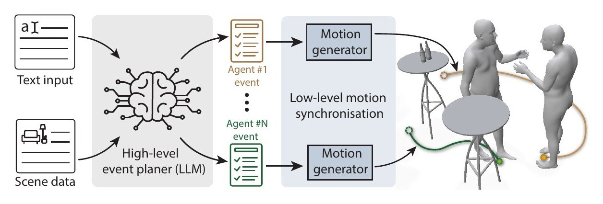
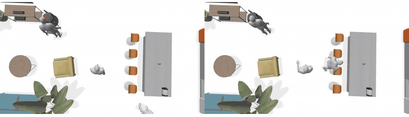

# SyncMOS

[](https://www.lingxiao.one/SyncMos_Project_page/)
[](https://www.lingxiao.one/SyncMos_Project_page/static/pdfs/syncmos.pdf)

Code for **SyncMos: Scalable Motion Synchronisation for Multi-Agent Scene Interaction** (CVPR 2026).

**TL;DR:** SyncMOS turns a scene and a written instruction into event plans and character motions, coordinating actions through temporal relationships such as parallel, before and after.



The high-level planner converts text and scene information into per-agent events. The low-level module synchronises the generated motions across agents.

## Run the House example

The commands below work from the repository root on Windows (PowerShell) and Linux. Install Git, [uv](https://docs.astral.sh/uv/getting-started/installation/) and an NVIDIA driver compatible with the project's CUDA 12.9 PyTorch build. Use a graphical session with OpenGL for the viewer. The first run needs internet access, several GB of free disk space and enough RAM to load the motion data (the joint array alone is about 1.9 GB).

### 1. Install the environment

```sh
git clone https://github.com/CGVXR-UniMelb/SyncMos.git
cd SyncMos
uv sync --locked --python 3.12
```

If you already cloned the repository, start with the last command in its root directory.

### 2. Configure one local .env file

Copy `.env.example` to `.env` in the repository root (`cp .env.example .env` on Linux or `Copy-Item .env.example .env` in PowerShell). Edit the copy. Keep an existing `.env` and add any missing entries to it.

| Entry | What to put in it |
| --- | --- |
| `OPENAI_API_KEY` | Your [OpenAI API key](https://platform.openai.com/api-keys) from a project with billing and access to the model in `configs/sample.yaml`. Generating a new plan can incur API charges. |
| `HUGGINGFACE_HUB_TOKEN` | First accept the [HSSD models access conditions](https://huggingface.co/datasets/hssd/hssd-models) while signed in. Create a [read token](https://huggingface.co/settings/tokens) for that account with permission to read the gated dataset. |
| `SMPLX_MALE_FILE` | Register and accept the terms on the [SMPL-X download page](https://smpl-x.is.tue.mpg.de/download.php), obtain the SMPL-X body models in NPZ format and unzip them locally. Enter the path to the extracted male file, e.g. `"C:/models/smplx/SMPLX_MALE.npz"`. The setup copies it into both paths used by SyncMos. |
| `SYNCMOS_LINGO_CHECKOUT` | Keep the template default `external/lingo-release`. The setup creates the pinned checkout there. An existing checkout at the validated revision can also be used. |
| `LINGO_UTILS_ZIP` | Leave empty for automatic download. If Google Drive blocks range requests or reaches its quota, download the authors' [lingo_utils.zip](https://drive.google.com/file/d/1L2V8RlPMAhWF93o_RpIznO_bacjSSLqu/view) yourself and enter its local path here. |

Keep `PYTHONUTF8=1` from the template so Python can read UTF-8 dependency files on Windows. Use forward slashes for Windows paths. Only `.env.example` belongs in version control.

### 3. Prepare scene resources

```sh
uv run --locked --env-file .env python -m src.scene.prepare_resources --scene House
```

The command obtains the pinned [LINGO source](https://github.com/mileret/lingo-release), selects the three checkpoints and six inference files from the official archive, downloads the HSSD meshes referenced by the scene, and prepares the CLIP text encoder. It checks the local files, CUDA availability and API key presence. Rerun the command after an interrupted download. A completed resource is reused. To run the local checks again without downloading, append `--check`.

Use `--scene Office` or `--scene Restaurant` for either other scene. To prepare all three at once, use:

```sh
uv run --locked --env-file .env python -m src.scene.prepare_resources --scene all
```

Model weights and inference data are shared across scenes. Object meshes shared by several scenes are downloaded once.

### 4. Launch the viewer and generate motion

```sh
uv run --locked --env-file .env python main.py scene_name=House num_characters=1 event_parser.use_vision=false
```

Paste this into **User Instruction**, then select **Generate New Motion**:

> Amir is standing at grid [17, 27] in the House. At grid [17, 27], Amir waves his right hand. After waving, Amir stands still at grid [17, 27]. He stays in the same spot throughout.

Click inside a viewer text field to use Ctrl+A, Ctrl+C and Ctrl+V. Pasting into an editable field replaces the selection or inserts at the cursor. You can drag to select text in read-only fields, including events and logs. To copy a control caption, right-click the control and select the caption in the popup.

The first generation builds the scene occupancy cache from the meshes and can take longer. Watch the character in the viewer. For Office or Restaurant, change `scene_name` to match the prepared scene and use an instruction appropriate for that layout. The viewer can also open a saved SyncMos NPZ. See [External LINGO Setup](EXTERNAL_LINGO_SETUP.md) for detailed file paths and diagnostics.



## Running the benchmark

The SyncMOS comparison contains 15 synchronization cases and 15 dependency cases. Run both methods with the fixed GPT-4o-mini preset:

```sh
uv run --locked python -m benchmark comparison --config configs/benchmark_comparison_4o_mini.yaml --experiment-name sync_gpt4omini --test-case-dir benchmark/test_cases/synchronization --repeat-count 1 --distraction-levels 0 --narrator-types baseline,timeline
```

```sh
uv run --locked python -m benchmark comparison --config configs/benchmark_comparison_4o_mini.yaml --experiment-name dep_gpt4omini --test-case-dir benchmark/test_cases/dependency --repeat-count 1 --distraction-levels 0 --narrator-types baseline,timeline
```

Each run saves per-case results, diagnostics and `summary.json` under `logs/benchmark_comparison/<experiment>/<run-id>/`. The preset uses `gpt-4o-mini-2024-07-18` at temperature 0.0. Other model presets are available under `configs/benchmark_comparison_*.yaml`.

Collect the existing event-coverage, dependency-accuracy and passed-scenario metrics:

```sh
uv run --locked python -m benchmark summary logs/benchmark_comparison/sync_gpt4omini logs/benchmark_comparison/dep_gpt4omini --output logs/benchmark_metrics.json
```

For the original interactive planning benchmark:

```sh
uv run --locked python -m benchmark planning
```

Use `python -m benchmark --help` for available commands, including the retained ablation runners. Each command also accepts `--help`.

**Windows paths:** Benchmark log names can exceed Windows path limits when the checkout path is long. Use a short checkout path or an unused drive alias before running the commands above. For example, in PowerShell:

```powershell
subst R: "C:/path/to/my-Event-Driven-Storytelling"
Set-Location R:/
```

After the benchmark finishes, leave `R:` and remove the alias with `subst R: /D`.

## Code Structure

```text
main.py                       Demo, generation and playback entrypoint
src/                          Planning, scene handling, motion synthesis and rendering
benchmark/                    Benchmark entrypoints, evaluation and case definitions
configs/                      Runtime, model and scene configurations
assets/                       SyncMOS architecture and demonstration media
licenses/                     Upstream license notices
EXTERNAL_LINGO_SETUP.md        Motion-generation resources and setup
```

## Citation

If you use SyncMos in your research, please cite our CVPR 2026 paper. GitHub also provides the citation through [CITATION.cff](CITATION.cff).

This project builds on [Event-Driven Storytelling](https://github.com/rms0329/Event-Driven-Storytelling) and uses external [LINGO](https://github.com/mileret/lingo-release) components for motion generation. If you use SyncMOS in your research, please consider citing the [SyncMOS paper](https://www.lingxiao.one/SyncMos_Project_page/static/pdfs/syncmos.pdf), the [Event-Driven Storytelling paper](https://openaccess.thecvf.com/content/ICCV2025/html/Lim_Event-Driven_Storytelling_with_Multiple_Lifelike_Humans_in_a_3D_Scene_ICCV_2025_paper.html), and the [LINGO paper](https://arxiv.org/abs/2410.03187).

```bibtex
@InProceedings{Li_2026_CVPR,
  author    = {Li, Lingxiao and Kim, Dongwon and Ruan, Lingyan and Chen, Bin and Kwon, Taesoo and Rhee, Taehyun},
  title     = {SyncMos: Scalable Motion Synchronisation for Multi-Agent Scene Interaction},
  booktitle = {Proceedings of the IEEE/CVF Conference on Computer Vision and Pattern Recognition (CVPR)},
  month     = {June},
  year      = {2026},
  pages     = {8174--8182}
}

@InProceedings{Lim_2025_ICCV,
  author    = {Lim, Donggeun and Bae, Jinseok and Hwang, Inwoo and Lee, Seungmin and Lee, Hwanhee and Kim, Young Min},
  title     = {Event-Driven Storytelling with Multiple Lifelike Humans in a 3D Scene},
  booktitle = {Proceedings of the IEEE/CVF International Conference on Computer Vision (ICCV)},
  month     = {October},
  year      = {2025},
  pages     = {11654--11664}
}

@inproceedings{jiang2024autonomous,
  title     = {Autonomous character-scene interaction synthesis from text instruction},
  author    = {Jiang, Nan and He, Zimo and Wang, Zi and Li, Hongjie and Chen, Yixin and Huang, Siyuan and Zhu, Yixin},
  booktitle = {SIGGRAPH Asia 2024 Conference Papers},
  pages     = {1--11},
  year      = {2024}
}
```

## License

The [root LICENSE](LICENSE) contains the proposed MIT terms for original contributions by The University of Melbourne and contributors, pending approval before public release. Event-Driven Storytelling retains its [original MIT notice](licenses/Event-Driven-Storytelling-LICENSE). See [third-party notices](THIRD_PARTY_NOTICES.md) for component-specific terms, attributions and outstanding permissions.

## Contact

For questions or problems with this implementation, open an issue in this repository.
